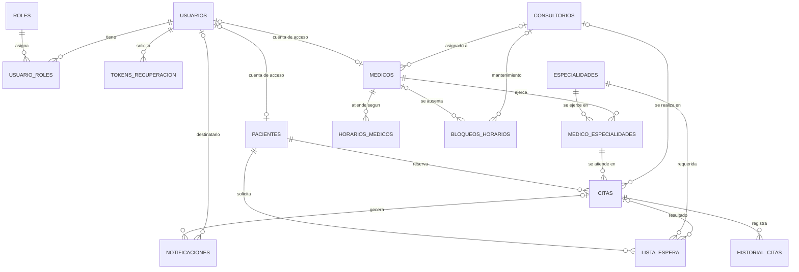

# MediGest — Modelo entidad-relación

Base de datos: `MediGestDB` (SQL Server). El esquema lo crea Flyway (`V1__esquema_base.sql`) y
Hibernate solo lo **valida** (`ddl-auto: validate`).

## Diagrama

`auditoria` no tiene claves foráneas a propósito: debe sobrevivir a cualquier cambio en las demás tablas.

## Relaciones y decisiones

| Relación | Cardinalidad | Decisión |
|---|---|---|
| usuarios ↔ roles | N:M (`usuario_roles`) | Un usuario puede tener más de un rol; los 4 roles se siembran en `V2`. |
| usuarios → pacientes / medicos | 1:0..1 | La cuenta de acceso es opcional (un paciente registrado por recepción puede no tener cuenta). Índice único filtrado `WHERE usuario_id IS NOT NULL`. |
| medicos ↔ especialidades | N:M (`medico_especialidades`) | Un médico puede ejercer varias especialidades. |
| medicos → consultorios | N:1 | Consultorio habitual. Dos médicos pueden compartirlo en distinto horario. |
| medicos → horarios_medicos | 1:N | Horario semanal en **hora local de la clínica** (ISO: 1 = lunes). Incluye descanso opcional. |
| bloqueos_horarios | N:1 a medico **o** consultorio | `CHECK` obliga a que tenga al menos uno. Tipos: vacaciones, ausencia, mantenimiento. El médico crea solicitudes (`SOLICITADO`); el administrador las aprueba. |
| citas → pacientes | N:1 | |
| citas → (medico, especialidad) | N:1 compuesta | La FK compuesta a `medico_especialidades` impide, en la propia base, reservar una especialidad que el médico no atiende. |
| citas → consultorios | N:1 opcional | Una cita puede ser sin consultorio (no presencial). |
| citas → historial_citas | 1:N | Cada creación, reprogramación, cancelación o cambio de estado deja una fila (fechas anterior/nueva, usuario, motivo). |
| lista_espera | N:1 a paciente y especialidad | Prioridad por orden de llegada (`creado_en`). La oferta temporal guarda médico, horario y vencimiento. |
| notificaciones | N:1 a cita y usuario (opcionales) | `clave_idempotencia` única evita enviar dos veces la misma notificación. |

## Restricciones clave

- **Zona horaria:** todos los instantes son `DATETIMEOFFSET(6)` en UTC; Lima (UTC−5) solo se usa al mostrar y en los horarios semanales.
- **Estados con `CHECK`:** citas, bloqueos, lista de espera, notificaciones, auditoría y tipos de documento solo admiten los valores definidos.
- **Reservas duplicadas (última barrera):** tres índices únicos filtrados sobre `citas` (médico, paciente y consultorio con el mismo `inicio_utc`) para citas que no estén `CANCELADA` ni `NO_ASISTIO`.
  SQL Server no tiene restricciones de exclusión, así que el **solapamiento parcial** (por ejemplo 10:00–10:30 contra 10:15–10:45) lo valida la capa de servicio con bloqueo pesimista en la Fase 5.
- **Concurrencia optimista:** `citas.version` (`@Version`).
- **Sin borrado físico:** no hay `ON DELETE CASCADE`; las bajas son lógicas (`activo`, estado `CANCELADA`).
- **Secretos:** `tokens_recuperacion` guarda solo el hash del token; `auditoria` y `notificaciones` no almacenan datos clínicos.

## Transiciones de estado de una cita

| Estado actual | Puede pasar a |
|---|---|
| PENDIENTE | CONFIRMADA, EN_ESPERA, CANCELADA, NO_ASISTIO |
| CONFIRMADA | EN_ESPERA, CANCELADA, NO_ASISTIO |
| EN_ESPERA | EN_ATENCION, CANCELADA, NO_ASISTIO |
| EN_ATENCION | ATENDIDA |
| ATENDIDA | — (terminal) |
| CANCELADA | — (terminal) |
| NO_ASISTIO | — (terminal) |

Así una cita cancelada no puede marcarse como atendida y una atendida no vuelve a pendiente.
La reprogramación no es una transición: solo se permite en `PENDIENTE` y `CONFIRMADA`, y conserva el estado.
Está implementado en `EstadoCita` y cubierto por `EstadoCitaTest`.
